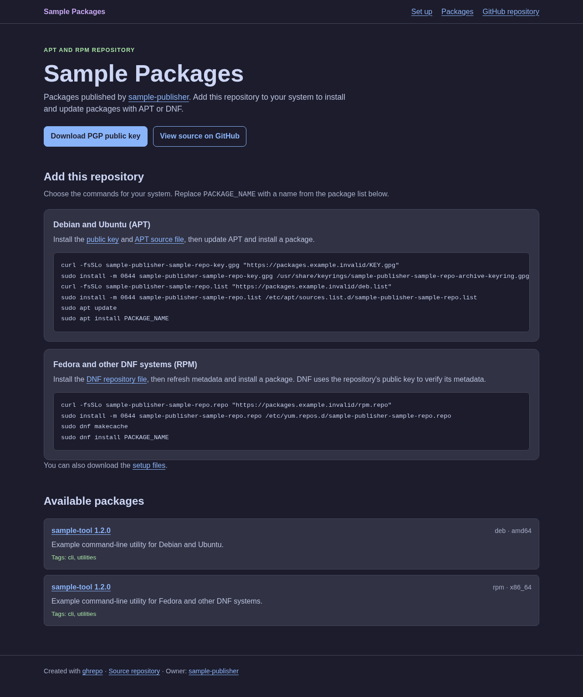

# ghrepo

Host signed DEB and RPM package repositories on GitHub Pages. Add packages from
public HTTPS URLs or upload local files to GitHub Releases, then publish APT and
DNF metadata and a packages page.

See [repo.moth.contact](https://repo.moth.contact/) for a live repository built
with ghrepo. It also publishes ghrepo DEB and RPM packages.

- [Install](#install)
- [Quick start](#quick-start)
- [Manage packages](#manage-packages)
- [GitHub Pages limits](#github-pages-limits)
- [Optional GitHub storage](#optional-github-storage)
- [Site configuration](#site-configuration)
- [Development](#development)
- [License](#license)

## Install

Install ghrepo from [repo.moth.contact](https://repo.moth.contact/):

### Debian and Ubuntu (APT)

```sh
curl -fsSLo KEY.gpg "https://repo.moth.contact/KEY.gpg"
sudo install -m 0644 KEY.gpg /usr/share/keyrings/ghrepo-archive-keyring.gpg
curl -fsSLo deb.list "https://repo.moth.contact/deb.list"
sudo install -m 0644 deb.list /etc/apt/sources.list.d/ghrepo.list
sudo apt update
sudo apt install ghrepo
```

### Fedora and other DNF systems (RPM)

```sh
curl -fsSLo rpm.repo "https://repo.moth.contact/rpm.repo"
sudo install -m 0644 rpm.repo /etc/yum.repos.d/ghrepo.repo
sudo dnf makecache
sudo dnf install ghrepo
```

### GitHub Releases

Download a Linux `amd64` or `arm64` binary archive from the
[ghrepo GitHub Releases page](https://github.com/asciimoth/ghrepo/releases).

### Nix

Install the CLI with Nix:

```sh
nix profile install github:asciimoth/ghrepo
```

To run it without installation:

```sh
nix run github:asciimoth/ghrepo -- --help
```

Get command help with `ghrepo --help` or `ghrepo COMMAND --help`.

## Quick start

### 1. Set up the repository

Install Git and GnuPG locally, then prepare the package repository:

1. Create a **public** repository. `ghrepo init` uses the checked out branch by
   default. Pass `--branch` to select a different branch.
1. In **Settings → Pages → Build and deployment**, set **Source** to **GitHub
   Actions**. See [GitHub's Pages instructions][pages-source]. Make sure GitHub
   Actions can run in the repository.
1. Clone the repository and enter its directory. Set up Git authentication so
   you can push to `origin`.
1. Create or select a local GPG signing key. If you omit `--key-id`,
   `ghrepo init` selects the first signing secret key listed by GPG and saves
   its fingerprint in `.ghrepo.local.yaml`. To select another key, find its ID
   with `gpg --list-secret-keys --keyid-format LONG` and pass `--key-id`.
   `ghrepo init` exports the selected public key, and `ghrepo publish` uses the
   selected key to sign repository metadata.

```sh
git clone https://github.com/OWNER/REPO.git
cd REPO
ghrepo init --repo OWNER/REPO --key-id YOUR_KEY_FINGERPRINT
```

`init` prints the chosen key fingerprint and its first GPG user ID. It also
prints the key during `--dry-run`. If GPG cannot provide key details, it prints
the configured key ID.

Replace `OWNER`, `REPO`, and `YOUR_KEY_FINGERPRINT` with your values. The
generated Pages workflow starts after you publish to the selected branch. For a
repository that does not exist yet, pass `--create-remote` and
`--configure-pages` to `init` to create it and select GitHub Actions for Pages.
Set `GH_TOKEN` for those API calls.

### 2. Add packages

Run these commands from the package repository directory. Replace the example
URL with a public DEB or RPM asset:

```sh
ghrepo add https://github.com/OWNER/PROJECT/releases/download/v1.0/app_1.0_amd64.deb
```

`add` verifies the package and updates `packages.yaml` and the local cache. It
does not publish. GitHub is the default allowed source host. For another host,
set `downloads.source_hosts` in `ghrepo.yaml`, or pass
`--source-hosts example.com` when you initialize the repository. Redirect hosts
must also be allowed. See the [format reference](docs/format-v1.md).

### 3. Publish and install

```sh
ghrepo publish --dry-run
ghrepo publish --message 'chore(repo): publish signed metadata'
```

`publish` downloads and verifies packages, signs and checks repository metadata,
then commits and pushes the repository files to `origin`. The generated GitHub
Actions workflow builds and deploys the Pages site.

Wait for the workflow to finish, then open `https://OWNER.github.io/REPO/`.
Follow the APT or DNF setup commands on the packages page to use the repository.

## Manage packages

### Select a repository directory

Run commands from the repository directory, or set `GHREPO_REPO_DIR` to its
local path. `--repo-dir DIR` overrides the environment variable:

```sh
export GHREPO_REPO_DIR=/home/user/myrepo
ghrepo sync
ghrepo --repo-dir /home/user/otherrepo check
```

Package file paths are relative to the current directory. Repository files,
cache, metadata, and Git operations use the selected repository directory.

### Common commands

These commands change or check local repository data. Run `ghrepo publish` when
you are ready to deploy changes.

| Command                          | Purpose                                                                     |
| -------------------------------- | --------------------------------------------------------------------------- |
| `ghrepo add URL`                 | Verify and add a DEB or RPM package.                                        |
| `ghrepo sync`                    | Download and verify packages in the manifest.                               |
| `ghrepo update`                  | Add new versions from upstream GitHub Releases.                             |
| `ghrepo source set SELECTOR URL` | Change a source URL after checking the stored size and SHA-256.             |
| `ghrepo replace SELECTOR URL`    | Replace bytes for the same package identity and retain the old served path. |
| `ghrepo remove SELECTOR`         | Mark a package as retained.                                                 |
| `ghrepo prune`                   | Preview retained paths eligible for removal.                                |
| `ghrepo prune --apply`           | Remove eligible retained paths from the manifest.                           |
| `ghrepo rebuild`                 | Build, sign, and verify APT and RPM indexes.                                |
| `ghrepo check`                   | Check source URLs, signatures, package bytes, and rendered site size.       |

A selector has the form `FORMAT/NAME/ARCHITECTURE/VERSION`. For example:

```sh
ghrepo source set deb/hello/amd64/1.2.0-1 https://example.com/hello-moved.deb
ghrepo replace deb/hello/amd64/1.2.0-1 https://example.com/hello-rebuilt.deb
ghrepo remove deb/hello/amd64/1.2.0-1
```

`prune` removes only retained paths whose retention period has passed and which
have no signed index or rollback reference.

### Add comments and tags

```sh
ghrepo add --comment "Example package" --tags cli,tools https://example.com/hello.deb
ghrepo metadata set --comment "Updated description" deb/hello/amd64/1.2.0-1
```

### Update packages from GitHub Releases

```sh
ghrepo update --dry-run
ghrepo update
ghrepo publish
```

`update` checks active packages with direct source URLs in this form:
`https://github.com/OWNER/REPO/releases/download/TAG/ASSET`.

It checks the latest published release for an asset with the same name, or a
name formed by replacing the old tag or package version. It verifies the package
format, name, and architecture before it adds a new version. Unsupported URLs
and releases without a matching asset are reported and skipped.

### Preview changes

Use `--dry-run` to preview a command without changing repository files or
sending mutation requests. It is available for `init`, `add`, `replace`, `sync`,
`source set`, `metadata set`, `remove`, `prune --apply`, `rebuild`, `check`,
`site-build`, and `readme-build`.

Two commands perform extra checks during a preview:

- `update --dry-run` downloads matching assets to temporary files and reports
  their versions without changing the repository or cache.
- `publish --dry-run` runs `sync`, `rebuild`, and `check` in a temporary copy,
  then prints the exact Git path changes. It does not commit or push.

### Publish changes

`publish` stages only configuration, templates, public keys, the manifest,
workflow, signed metadata, and the rendered README. It reports each stage and
public source check on standard error. Long downloads report progress every 15
seconds.

`rebuild` replaces metadata as one recoverable transaction. The ignored
`.ghrepo-transaction/` directory records interrupted swaps; the next `rebuild`
or `check` restores them.

## GitHub Pages limits

Plan for these [GitHub Pages limits][pages-limits]:

| Resource          | Limit                                                                                                   |
| ----------------- | ------------------------------------------------------------------------------------------------------- |
| Published site    | Maximum 1 GB.                                                                                           |
| Source repository | Recommended maximum 1 GB.                                                                               |
| Bandwidth         | Soft limit of 100 GB per month.                                                                         |
| Deployment        | Times out after 10 minutes.                                                                             |
| Builds            | Soft limit of 10 per hour; does not apply to custom Actions workflows such as the one ghrepo generates. |

GitHub can rate-limit requests or stop serving sites that exceed its quotas.

**All active and retained packages count toward the deployed site size.** GitHub
Releases storage does not bypass this limit: `site-build` copies package bytes
into the Pages artifact. Package downloads from the site also use Pages
bandwidth.

`ghrepo check` verifies the rendered artifact size against `site.max_bytes` and
ghrepo's 1 GiB ceiling. Set a lower `site.max_bytes` to leave space for updates.
Use `prune` to review expired retained packages before removing them.

## Optional GitHub storage

Set `storage.backend: github-releases`, `storage.release_prefix`, and
`storage.bucket_size` (1–1000) in `ghrepo.yaml`. Set `GH_TOKEN` in the
environment or ignored local settings. Release uploads need repository Contents
write access. Include `github.com` in `downloads.source_hosts` for uploads.

After you configure storage, upload local packages:

```sh
ghrepo add --upload ./hello.deb ./tool.rpm
ghrepo add --upload --sign-rpm ./tool.rpm
ghrepo gc
```

`add --upload` puts SHA-256-named assets in numbered releases, checks their
public bytes, and then adds their URLs to the manifest. If the same package has
an upstream URL, it changes that entry to the owned URL after verification.

With the trusted RPM package policy, it signs a copy when the original signature
is not trusted and a local signing key is configured. `--sign-rpm` requests a
signed copy explicitly.

Repeat an interrupted upload command to resume it; an existing asset is checked
before use. `gc` reports unreferenced owned assets but does not delete them. It
protects references in the current manifest and branch or tag tip manifests.
Upload progress stays in ignored `.ghrepo-upload/` until the manifest is saved.

This bucket policy requires mutable GitHub Releases. The adapter reuses a
verified asset in an existing immutable release but cannot add new assets to
one.

## Site configuration

### Change the site URL

`init` accepts `user/repo` or a full GitHub HTTPS URL for `--repo`. It stores
the full URL in `ghrepo.yaml`. If `--site` is absent, it uses
`https://user.github.io/repo`. For a `user.github.io` repository, it uses
`https://user.github.io`. Set `--site` to use a custom domain.

To change the site URL of an existing repository, run this command from its
local directory, then publish the change:

```sh
ghrepo init --site https://repo.example.com
ghrepo publish
```

Use an HTTPS URL without a trailing slash. The URL is used as supplied: a custom
domain has no repository-name path unless you include one.

An explicit `--site` updates `site.base_url` and sets `site.cname` to the custom
hostname. A GitHub Pages hostname clears `site.cname`. Running `init` without
`--site` keeps the saved site settings. Existing packages, signed metadata,
local settings, and templates are preserved.

The next site build renders the client configuration and links with the new URL.
Configure DNS and the Pages custom domain separately, and update installed
clients to use the new URL.

### Download timeouts

In `ghrepo.yaml`, set `downloads.connect_timeout_seconds` and
`downloads.request_timeout_seconds` to change the default connection limit of 10
seconds and full request limit of 600 seconds.

### Pages workflow

The generated Pages workflow downloads the latest published ghrepo release for
Linux amd64. It verifies the archive signature with the release public key
embedded in the workflow before it runs the binary. If the release signing key
changes, update the generated workflow in each repository. Existing repositories
keep their committed workflow until you replace it with a newly generated one.

The generated Pages workflow runs `ghrepo site-build` from a clean checkout.
This command downloads all active and retained packages from their HTTPS source
URLs, checks their size and SHA-256, verifies the signed APT and RPM metadata
with `KEY.gpg`, and writes `build/site/`. It needs `gpgv` for public-key
verification. It does not need a private key or package-management tools.

A failed build keeps the previous `build/site/` directory. The artifact also
contains the rendered landing page, download script, and APT and RPM client
files from the committed templates.

### Packages page

`ghrepo init` creates `templates/index.html`, which becomes the site's
`index.html` packages page. By default, it uses Catppuccin Mocha colors and
shows APT and DNF setup commands, active packages, the GitHub owner and source
repository, the public PGP key, and a link to ghrepo.



The preview uses fictional package data and URLs under `example.invalid`.

The setup commands use `deb.list` and `rpm.repo` from the site. Installed files
and the DNF repository ID use a name derived from the repository owner and name.
`init` writes the owner name into the default template from the repository URL.

Edit the source template to change the text, HTML, links, or package layout.
`init` does not overwrite edited templates. The site builder reads the source
template on each build. Run `ghrepo check` to check the rendered site, then
`ghrepo publish` to commit and deploy your changes.

The template uses Go expressions in `{{` and `}}`. The available data is:

| Expression    | Value                                                                                      |
| ------------- | ------------------------------------------------------------------------------------------ |
| `.BaseURL`    | `site.base_url` from `ghrepo.yaml`, without a trailing slash.                              |
| `.SetupName`  | Lowercase owner and repository name for local setup files and the DNF repository ID.       |
| `.Repository` | The validated `ghrepo.yaml` data, such as `.Repository.RPM.ID` and `.Repository.RPM.Name`. |
| `.Packages`   | All entries from `packages.yaml`, including active and retained packages.                  |
| `.GPGCheck`   | `1` for `trusted-packages`; `0` for `metadata-only`.                                       |
| `.RPMKeyURLs` | Space-separated public URLs for the repository key and trusted RPM keys.                   |

Each item in `.Packages` has `.State`, `.Path`, `.Format`, `.Identity`, and the
other fields defined in `packages.yaml`. For example, `.Identity.Name`,
`.Identity.Version`, and `.Identity.Architecture` identify a package. Filter on
`.State` if a list must contain only active packages. Use `$.BaseURL` inside a
`range` to refer to the site URL; `.` then refers to the current package.

For example, this HTML in `templates/index.html` makes a list of active DEB
packages:

```html
<h1>{{.Repository.RPM.Name}}</h1>
<ul>
{{range .Packages}}{{if and (eq .State "active") (eq .Format "deb")}}
  <li><a href="{{$.BaseURL}}/{{.Path}}">{{.Identity.Name}} {{.Identity.Version}}</a></li>
{{end}}{{end}}
</ul>
```

`index.html` uses Go's `html/template`, which escapes package values for HTML.
The builder requires `templates/index.html`. Template parse errors or unknown
fields fail the site build.

### Repository README

`ghrepo init` creates `templates/README.md` and renders it to the repository
root as `README.md`. Edit the template to change the README. Run
`ghrepo readme-build` to render it after package or template changes. The
template uses Go's `text/template` with `.Repository`, `.Packages`, and
`.BaseURL`. `ghrepo publish` renders the README after checking the repository
and includes the template and rendered file in its commit. A template error
leaves the previous README intact.

## Development

### Build and check

Run these commands from the ghrepo source checkout:

```sh
nix develop
just build
just run --help
```

The flake also provides `packages.<system>.ghrepo`. See
[the format contract](docs/format-v1.md) for repository rules and fixture
details.

| Command         | Purpose                                                                                        |
| --------------- | ---------------------------------------------------------------------------------------------- |
| `go test ./...` | Run a quick test check.                                                                        |
| `just test`     | Run tests with the race detector and coverage.                                                 |
| `just lint`     | Run Go linters.                                                                                |
| `just vet`      | Run `go vet`.                                                                                  |
| `just fmt`      | Format Go and Markdown files.                                                                  |
| `just check`    | Run all checks, including Nix, Docker, and fuzz tests. Can change formatting and module files. |
| `just --list`   | List all recipes.                                                                              |

Normal tests use local files and TLS servers. A manual check in a disposable
public repository can confirm GitHub Pages deployment behavior.

### Docker compatibility tests

Run `just test-e2e` with Docker available. The test builds Linux test binaries
and runs the generated repositories through APT and `dpkg` in Debian, and DNF
and `rpm` in AlmaLinux. It checks repository refresh, package download, and
installation. The RPM test also checks both package signature policies. Docker
downloads the images and their test tools on the first run. The normal
`just test` command does not require Docker.

The same job checks package inspection against `dpkg-deb` and `rpm`. It builds
gzip DEBs for `amd64`, `arm64`, and `all`, checks control archive layouts and
field syntax, and compares RPM identity and dependency fields for gzip, xz, and
zstd fixtures. RPM builds also cover translated summaries and descriptions,
nonzero epochs, and filenames containing two dots. These tests use temporary
files and do not install packages. To run only these checks with `dpkg-deb`,
`rpm`, and `rpmbuild` on `PATH`:

```sh
GHREPO_DEB_COMPAT=1 GHREPO_RPM_COMPAT=1 GHREPO_RPM_BUILD_COMPAT=1 \
  go test ./inspect -run 'Test(DEBDpkg|RPMTool|RPMBuild)' -v
```

Without these environment variables, `go test ./inspect` skips a tool check when
the tool is unavailable. The archive and field regression tests always run
offline.

Run `go test ./inspect -run '^$' -fuzz '^FuzzDEBInspection$' -fuzztime 10s` to
exercise malformed DEB inputs. Use `-fuzz '^FuzzRPMInspection$'` to exercise
malformed RPM headers.

`just fuzz` also runs focused targets for DEB gzip, tar, and control fields and
for RPM headers and embedded OpenPGP signature packets. Each target keeps the
outer archive valid so changes reach the parser under test.

### Make a release

The release command builds Linux `amd64` and `arm64` binaries. GoReleaser makes
`tar.gz`, DEB, and RPM files for each architecture. It adds a detached GPG
signature for each archive and package, signs the checksum file, and publishes
them in a GitHub Release. The DEB and RPM packages do not contain embedded
signatures; verify their `.sig` files before installation.

Install the release tools with `nix develop`. Configure GitHub authentication
with `GITHUB_TOKEN` or `GH_TOKEN` (the token needs `contents: write`), or sign
in with `gh auth login`. Set `GPG_KEY_ID` to the fingerprint of a local GPG
secret key. Do not commit the token or secret key.

Commit all changes, then run the command from the branch you want to release:

```sh
export GPG_KEY_ID=YOUR_KEY_FINGERPRINT
just release 1.2.3
```

The command runs `just check` and a local signed snapshot build before it
creates and pushes the `v1.2.3` tag. GoReleaser then uploads the signed files.
The release stops if the working tree is not clean or the tag already exists.

To add the uploaded DEB and RPM packages to a local ghrepo repository, set
`GHREPO_REPO_DIR` to its directory before running `just release`. The release
command reads the package names from GoReleaser, adds their GitHub Release URLs
with `ghrepo add`, and verifies the downloaded packages. The repository must
allow `github.com` as a source host. The command updates `packages.yaml`; run
`ghrepo publish` after the release to build and push repository metadata.

Verify a downloaded asset and its detached signature with
`gpg --verify FILE.sig FILE`; import and trust the release public key first.

## License

Licensed under the GNU General Public License v3.0 only (`GPL-3.0-only`). See
[LICENSE](LICENSE) for the full terms.

[pages-limits]: https://docs.github.com/en/pages/getting-started-with-github-pages/github-pages-limits
[pages-source]: https://docs.github.com/en/pages/getting-started-with-github-pages/configuring-a-publishing-source-for-your-github-pages-site#publishing-with-a-custom-github-actions-workflow
